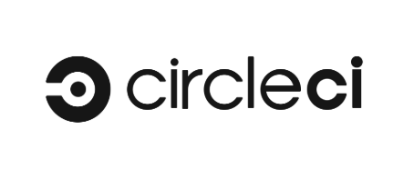

<h1>
  <span class="headline">CI & Automation Basics</span>
  <span class="subhead">Introduction to Continuous Integration</span>
</h1>

**Learning Objective:** Explain the purpose of Continuous Integration (CI) and how it supports test reliability and development velocity.

## What is continuous integration?

Continuous Integration, known as _CI_, is a practice in software development where each team member integrates their changes into a shared branch frequently—often several times each day. Every time code is merged, automated builds and tests run to check for issues right away.

If you have ever found yourself working on a feature, only to discover much later that your changes do not align with others', you have seen the kind of frustration CI helps to prevent. With CI, integration is not something that happens at the end of a project—it is an ongoing activity that becomes part of the daily workflow.

Automated steps—such as linting, building, and testing—run every time someone pushes code to the shared repository. This ensures problems are caught early.

> 💡 Think of CI as a daily health check for your project. Rather than waiting until there are symptoms, you are constantly monitoring the codebase so challenges are manageable.

### Core principles of CI

- **Frequent integrations:** Developers push code updates multiple times a day, keeping everyone in sync.
- **Automated builds:** Each push triggers an automated build, confirming the code compiles or runs as intended.
- **Automated testing:** A suite of automated tests—like those you have written using _pytest_ or _Selenium_—run to make sure new code does not break existing functionality.
- **Visibility:** The whole team can see the status of the latest build and tests, receiving quick feedback on the state of the project.

> Automated builds and tests together help to create a shared responsibility for the codebase. Every change is everyone's concern.

## Why use continuous integration in modern software development?

Today, development teams often work across time zones and release new features frequently. CI is crucial because it makes this pace sustainable by integrating and testing code consistently.

**Benefits of CI include:**

- **Early bug detection:** CI catches bugs soon after they are introduced, making them easier and less costly to fix.
- **Reduced merge conflicts:** Smaller, frequent updates help isolate and resolve merge conflicts efficiently.
- **Faster releases:** Keeping code in a deployable state at all times enables confident, timely releases.
- **Improved collaboration:** CI creates a transparent environment where everyone can see and share progress, fostering better teamwork.

**Scenario:**  
Imagine working on a team building an online marketplace. Without CI, one developer might change how the checkout process works, while another modifies how payment validation happens. Integrating these features only after a week could reveal complex conflicts and failures. With CI, both changes would be tested together the same day, and issues would be discovered while they are still small and easier to address.

## How CI enhances test reliability and development speed

Automated testing within a CI process provides a safety net that helps your team move quickly—while still trusting the code.

### Test reliability

When automated tests run in a consistent environment every time code changes, results are predictable and repeatable. For example, CI tools often use virtual machines or containers to run tests, removing differences in individual developer laptops.

This approach brings several advantages:

- Tests provide fast, consistent feedback, regardless of who is running them or where.
- When a test fails, you immediately know which change caused the issue.
- Over time, this builds trust in your tests and allows the team to move quickly without being afraid of breaking something.

> 🏆 Best practice: Never rely on tests passing _only_ on your local machine. CI ensures the tests reflect the real deployment environment.

### Development velocity

- **Immediate feedback:** Every code push triggers automated feedback, helping you catch and fix issues before they slow down the team.
- **Automated gatekeeping:** No code can be merged unless it passes all required tests. This keeps the main branch stable for everyone.
- **Reduced manual effort:** Developers spend less time performing repetitive manual tests and more time building new features.

> 💡 Many developers report that after adopting CI, they feel more confident deploying code and spend less time investigating unexpected bugs.

## Real-world examples of CI implementation in tech companies

Many organizations use CI to support fast-paced, high-quality development.

### Example: GitHub

At GitHub, every pull request triggers a CI pipeline that runs tests across multiple environments. Code cannot be merged until all checks are successful. This is true no matter how experienced the developer may be, helping maintain code quality at scale.

### Example: Spotify

Spotify supports many small teams working on different services, all using CI pipelines to verify code across their infrastructure. By encouraging frequent code merges and automated tests, Spotify can release features to millions of users regularly and with confidence.

## Overview of popular CI tools and platforms

Your choice of CI tool depends on your repository hosting service and team needs. Here are some of the most widely used platforms:

### GitHub Actions


<br>

- Built right into GitHub repositories.
- Custom workflows managed in _YAML_ files.
- Well-suited for both open-source and private projects.

**Example configuration:**

<code class="filepath">.github/workflows/ci.yml</code>

```yaml
name: Python package

on: [push, pull_request]

jobs:
  build:
    runs-on: ubuntu-latest

    steps:
      - uses: actions/checkout@v4
      - name: Set up Python
        uses: actions/setup-python@v5
        with:
          python-version: '3.11'
      - name: Install dependencies
        run: |
          pip install -r requirements.txt
      - name: Run tests
        run: |
          pytest
```

### GitLab CI


<br>

- Integrated into GitLab repositories.
- Pipelines defined in <code class="filepath">.gitlab-ci.yml</code>.
- Supports both cloud and on-premises workloads.

**Example configuration:**

<code class="filepath">.gitlab-ci.yml</code>

```yaml
stages:
  - test

test:python:
  stage: test
  image: python:3.11
  script:
    - pip install -r requirements.txt
    - pytest
```

### Other notable platforms

| Logo                                                                      | Platform Description                                                                |
| ------------------------------------------------------------------------- | ----------------------------------------------------------------------------------- |
|      | **Jenkins**: Flexible and highly customizable. Works with many languages and tools. |
|   | **CircleCI**: Cloud-based, fast to set up, and scalable.                            |
|  | **Travis CI**: Simple to configure, used by many open-source Python projects.       |

All these tools help automate steps like installing dependencies, linting, running tests, and eventually deploying software.

> 📚 _Continuous Integration (CI)_ is the practice of merging and testing code frequently using automated pipelines to detect and resolve issues early.
