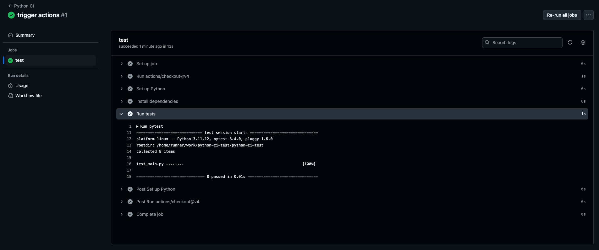

<h1>
  <span class="headline">CI & Automation Basics</span>
  <span class="subhead">Setting Up a CI Pipeline</span>
</h1>

**Learning objective:** Set up a basic CI pipeline using GitHub Actions to automatically run Python and Selenium tests.

## What is GitHub Actions?

Continuous Integration (CI) helps catch bugs early by automatically testing code every time it's updated. GitHub Actions is a built-in feature of GitHub that lets you create automation workflows using simple `.yaml` files.

Each time you push code or open a pull request, GitHub runs your workflow—like installing dependencies and running tests—on a clean virtual machine. This ensures consistent results every time, no matter whose computer the code came from.

> 💡 **Think of GitHub Actions as a team member** who checks your code automatically before it goes live.

## Anatomy of a Simple Workflow

Workflows typically live in a `.github/workflows/` folder.

A workflow file describes:

- **Triggers**: When should this workflow run? (ex: on push or pull request)
- **Jobs**: What steps should run, and on what system?
- **Steps**: Commands to check out code, set up Python, install packages, and run tests

**Sample file:** `.github/workflows/ci.yml`

```yaml
name: Python CI

on: [push, pull_request]

jobs:
  test:
    runs-on: ubuntu-latest

    steps:
      - uses: actions/checkout@v4
      - name: Set up Python
        uses: actions/setup-python@v5
        with:
          python-version: '3.11'
      - name: Install dependencies
        run: pip install -r requirements.txt
      - name: Run tests
        run: pytest
```

> 🏆 Why this matters: These are the same steps you might run locally—now they’re automatic and consistent for everyone on your team.

## Creating a basic workflow to run Python tests

Let’s connect these concepts to a familiar Python testing workflow, using _`pytest`_ as our testing tool.

If you were setting up a workflow for the first time, here is a simple overview of things you would need to define:

1. **Define when to run the workflow:** Use `on: [push, pull_request]` to trigger on repo updates or pull requests.
2. **Specify the job environment:** Create a job named `test` that runs in a fresh Ubuntu environment.
3. **List workflow steps:**
   - Check out your repository using an official action.
   - Set up Python (choose the version your project uses).
   - Install dependencies from `requirements.txt`.
   - Run your test suite with _`pytest`_.

> This represents the automation of a process you may already run locally—but now, every team member benefits from the same steps, in a predictable environment.

This practice eliminates “it works on my machine” issues, because every test runs in a clean, reproducible cloud environment.

### Configuring triggers for the CI pipeline

_Triggers_ control when your workflow runs. The two most common triggers in Python projects are:

- **push:** Fires every time code is pushed.
- **pull_request:** Fires on any new or updated pull request.

You can target specific branches or let the workflow run for every change:

**Trigger for only `main` branch:**

```yaml
on:
  push:
    branches:
      - main
  pull_request:
    branches:
      - main
```

**Trigger for any branch or PR:**

```yaml
on: [push, pull_request]
```

Suppose you only want to check deployable code—configure the trigger to cover only your deployment branch. If your team is in active development, allow the workflow on all branches for tighter feedback loops.

> 💡 _Best practice:_ Adjust your triggers to balance feedback frequency against resource usage and team needs.

<div class="activity guided-walkthrough">
  <h2 class="title">Creating a simple CI pipeline for a Python project</h2>
  <span class="minutes">20 min</span>
</div>

Let’s apply what you’ve just learned by setting up and validating a basic CI workflow that runs _pytest_.

1. **Open your project folder on your computer**  
   This should be the `ci-and-automation-basics` project you created during **_setup_** for this lesson.

   This project contains two files:

   - `main.py` with sample functions for an e-commerce system
   - `test_main.py` with unit tests for those functions

   In this walkthrough, you’ll create a GitHub Actions workflow that runs your tests automatically each time you push to your repository.

2. **Create a new folder in the project named `.github/workflows/`**

   - In your project folder, create a folder named `.github`.
   - Inside `.github`, create another folder named `workflows`.
   - Final structure: `.github/workflows/`

3. **Inside that folder, create a new file called `ci.yml`**

   - You can do this using your code editor or terminal.
   - Full path: `.github/workflows/ci.yml`

4. **Copy the sample workflow YAML into the file**  
   Use the YAML example provided earlier in this lesson. It tells GitHub to run your tests automatically whenever code is pushed or a pull request is created.

5. **Create a `requirements.txt` file to list your test dependencies**

   - In the root of your project (same place as `main.py`), create a new file called `requirements.txt`
   - Add the following line to the file:

     ```
     pytest
     ```

   - Save the file.

6. **Customize the Python version if needed**

   - In the `ci.yml` file, update the `python-version` field to match the version you’re using (ex: `3.11`)

7. **Save all files, commit your changes, and push to GitHub**

   - Example terminal commands:

     ```bash
     git add .
     git commit -m "Add basic GitHub Actions CI workflow"
     git push
     ```

8. **Trigger the workflow**

   - Make a small change in any file (even just a comment) and push it to GitHub.
   - This should trigger the CI workflow automatically.

9. **Watch the workflow run on GitHub**

   - Go to your repository on GitHub.
   - Click on the **Actions** tab.
   - Find your workflow (it will likely be called "Python CI").
   - Click it to watch the steps execute live.
   - You should see your test results at the bottom—either a green checkmark (✅ passed) or a red X (❌ failed).

> 💡 Tip: If your tests don’t pass right away, don’t worry! Use the logs in the Actions tab to see what went wrong. Part of learning CI is learning how to debug when things don’t go perfectly.




## Knowledge checks

❓ Which section of a GitHub Actions workflow file specifies the events that start the workflow?

- A) jobs
- B) on
- C) steps
- D) runs-on
